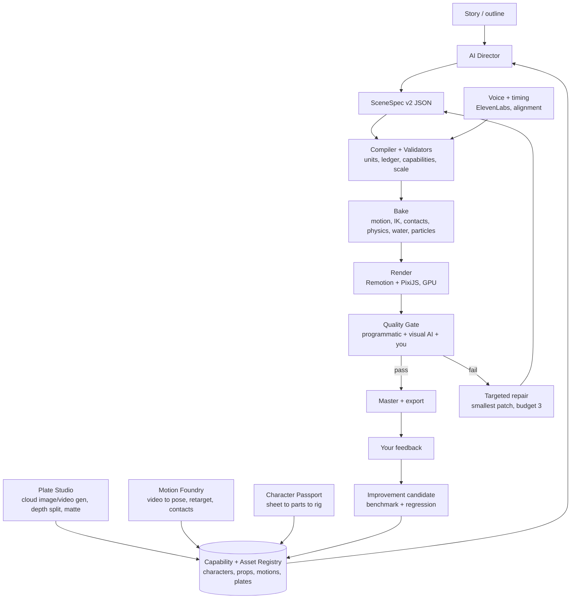

# AI Stickman Engine — Architecture v2

Builds on plan v1.0 (see `00-plan-review.md`). **Principle: generative models create *looks*; the engine owns
*truth*.** Characters, props, physics, timing and text come from versioned, validated, deterministic data. Generated
media enters only as style-locked background plates and hero effect plates.



## 1. Canonical units and coordinates
- World unit is the **metre**. Person = 1.70 m, child (Mia) = 1.30 m, floor height = 3.2 m, car = 4.5 × 1.5 m, door = 2.0 × 0.9 m.
- Screen scale comes only from the camera (pixels per metre × zoom). No asset carries a pixel size.
- **Scale validator** (compiler): every prop and building declares its real size; a scene fails if any ratio is off by
  more than 15% (person:door, person:floor, person:car).

## 2. SceneSpec v2
```json
{
  "sceneId": "p3_hit", "fps": 30, "durationFrames": 210, "seed": "qc-p3-hit-1",
  "units": "m",
  "ledgerIn": "p3_s5_end",
  "cast": [{"id": "ravi", "passport": "ravi@4"}, {"id": "mia", "passport": "mia@2", "carriedBy": "ravi"}],
  "props": [{"id": "tower", "asset": "harbor_tower@3"}, {"id": "debris", "asset": "wreck_set_flood@2", "count": 14}],
  "plates": [{"layer": "far", "asset": "drowned_city_dawn@1"}],
  "shots": [
    {"from": 0, "to": 75, "framing": "wide", "camera": {"track": "follow", "subject": "wave_front"}},
    {"from": 75, "to": 140, "framing": "medium", "subject": ["ravi", "mia"]},
    {"from": 140, "to": 210, "framing": "close", "subject": "ravi"}
  ],
  "actions": [
    {"actor": "ravi", "motion": "shield_child@1", "start": 80, "contacts": ["feet:roof", "hands:mia"]},
    {"actor": "water", "type": "surge", "start": 0, "impactFrame": 120, "crestFloorBelowRoof": 1}
  ],
  "physics": {"tiers": ["rigid", "heightfield", "spray"], "debrisDensity": "medium"},
  "audio": [{"cue": "impact", "frame": 120, "layers": ["boom", "crash", "rumble"]}],
  "text": [{"type": "slam", "text": "HOLD ON!", "frame": 70}],
  "constraints": ["feet_contact", "scale_valid", "no_penetration", "identity_match", "caption_safe_zone"]
}
```
Every field resolves to an immutable version before baking (`asset@version`).

## 3. World State Ledger (continuity)
A typed record of everything that must not reset between shots or parts: time of day, weather, water level, structural
damage (mast leaning, tower intact), costume state (torn apron, wet), prop ownership (who holds the flashlight), injuries
and character positions at scene boundaries. Rules: monotonic fields (damage, wetness) never decrease; time only moves
forward unless a shot is tagged as flashback; positions at scene end equal positions at the next scene's start. Built
on the existing validator in `src/story/schema.ts`.

## 4. Character Passport (consistency)
1. **Input:** a turnaround sheet you generate (ChatGPT / Google Flow) to the spec in `05-asset-specs.md`.
2. **Segment** into parts: head, torso, upper/lower arms, hands, thighs, shins, feet, costume overlays.
3. **Annotate** joints and pivots, part layering (near/far limbs) and limits.
4. **Rig** with a skeleton, 2-bone IK for arms and legs, foot and hand locks, squash/stretch limits.
5. **Fingerprint:** limb-length ratios, palette, silhouette area per pose, line weight.
6. **Render-time identity check:** crop each character per sampled frame and compare it with the fingerprint (ratios
   exact, palette ΔE below threshold, embedding similarity calibrated on your approved shots).

Faces stay minimal for now; costume elements carry identity (Ravi's apron, Mia's yellow raincoat).

## 5. Prop Registry (objects that behave like objects)
```json
{"id": "car_sedan", "version": 2, "size_m": [4.5, 1.5], "mass_kg": 1300, "density": 0.35,
 "collider": "convex:car_sedan.poly", "states": ["intact", "dented", "wreck", "half_sunk"],
 "waterline": {"floatsAt": 0.6, "tilt_deg": [10, 25]}, "layers": ["body", "glass_cracked", "wheels"],
 "attach": {"roof": [0.2, -0.75]}}
```
Every floating, breaking or carried object must come from the registry. The renderer clips sprites at the computed
waterline, draws a foam ring and applies a refraction offset below the surface.

## 6. Physics: four tiers, all baked and tested
| Tier | Model | Bake output | Verification tests |
|---|---|---|---|
| 1. Rigid bodies | Rapier 2D, deterministic build, fixed 1/120 s step | Per-body transform tracks | No tunnelling; rest stable; same seed gives the same track |
| 2. Water surface | 1D heightfield (shallow-water or wave superposition) with obstacles and surge fronts | Surface height per x per frame | Wave speed ≈ √(g·depth) within 15%; mass conserved; floating bodies reach buoyancy equilibrium |
| 3. Spray and foam | Seeded particles emitted from impacts, wave crests and debris | Particle tracks | Impact cues trigger spray within 1 frame; particles respect gravity; no spray from calm water |
| 4. Hero plates | Generated wave/crash clips (cloud), matted and composited | Video layers | Plate horizon and lighting match the scene; plate timing locked to the impact frame |

Building collapse uses tier 1 with pre-fractured pieces (damage states in the Prop Registry).

## 7. Motion Foundry
Reference video (you acting, or licensed clips) → 2D pose estimation (MediaPipe / RTMPose, CPU) → retarget to the rig
skeleton → contact detection (foot plant, hand grip) → filtering → clip with metadata (loopable, blend-in/out frames,
speed in m/s, contacts). At bake time, clips are blended, feet and hands are locked to contact surfaces (roof, stair
treads, ladder rungs, raft) and IK resolves the last centimetres. Starter library: idle, walk, run, run-stop,
stairs-up, climb-ladder, jump-gap, carry-child, shield-crouch, paddle, slip-recover, look-up, flashlight-raise, wave.

## 8. Plate Studio (looks)
Style lock (a reference board, and later a cloud-trained style model) → generate plates per shot from the shot list
(9:16, ≥ 2048 px tall) → depth estimation → split into 3–5 layers with gaps filled → parallax camera. Hero effect plates
(wave crest, crash) come from a video model, are matted and colour-matched. All generation runs in the cloud; your PC
handles the depth split and compositing.

## 9. Render
Remotion controls frames, audio and export; PixiJS draws layers on the GPU (Vulkan backend: measured ~15× faster than
software rendering on the GTX 1050). Per frame: `t = frame / fps` → sample baked tracks → draw plates, world, water
shader, characters, particles and text → lighting (rim light, contact shadows) → per-act colour grade → grain. No
independent tickers.

## 10. Sound
Event-bound sound effects (each physics event emits a cue with intensity), layered effects from a licensed library, music
stems (calm, tension, action, hope) with ducking under voice, 3–5 voice takes per line with emotion tags, and
master at −14 LUFS.

## 11. Quality gate and repair
Programmatic checks first (thresholds in `04-quality-scorecard.md`), visual AI review on event keyframes (labelled
advisory) and your review on benchmark shots. Each defect is recorded as `{scene, frames, category, evidence,
confidence, fix}`. Repair patches the smallest field, motion or asset, re-checks dependents, keeps the best candidate,
and stops after 3 attempts.

## 12. Learning loop and infrastructure, staged
- **Pilot:** files only (`runs/<id>/manifest.json`, approved examples in `registry/`), CLI tools, git for versions.
- **After the gates pass:** SQLite/PostgreSQL for attempts and feedback, then the job queue and API, then the Next.js
  editor (the v1.0 diagram). pgvector only when there are more than a few hundred approved examples.

## 13. Determinism and environment
Pin the Chrome version, the Remotion version and `--gl=vulkan`. Within one environment, re-rendered frames must be
bit-identical. Across GPU backends we measured PSNR ~47 dB; the cross-environment tolerance is set at ≥ 45 dB.
