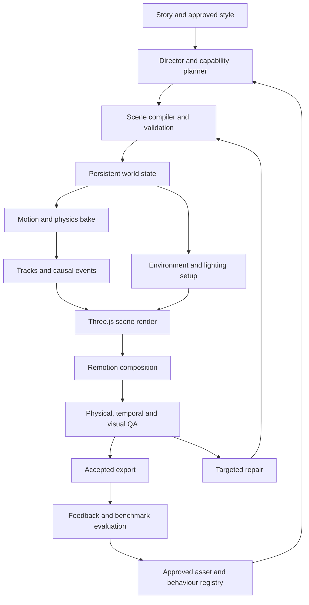

# AI Stickman Engine — Implementation Plan

**Version:** 3.1  
**Date:** 23 October 2026  
**Prepared for:** Suprotim Mukherjee  
**Status:** Approved to start Milestone 0. Implementation quality and performance remain to be demonstrated.

This standalone plan consolidates the supplied version 2 plan and the subsequent realism review. It covers a reusable engine for many scene types. Tsunami survival is one demanding demonstration, alongside ordinary character action, vehicles, weather, animals and material interactions.

**Artwork decision:** approved reusable assets, procedural construction and conventional authoring are the primary route. **Google Flow and ChatGPT/GPT image generation are optional authoring-time sources.** An approved generated image becomes an ordinary registered asset. Rendering and simulation never call a generator, so they work with generation disabled.

### What changed in 3.1

| # | Change | Where |
| --- | --- | --- |
| 1 | Reuse the working Quiet Coast pipeline instead of rebuilding it; the current engine keeps rendering until the new one matches it | §3.4, §15.1, §14.0 |
| 2 | Named art director (the project owner); style bible is a Milestone 0 deliverable; approved generated artwork is first-class for hero looks | §2.1, §2.2, §2.4 |
| 3 | Pilot flood fields come from an in-repo TypeScript shallow-water solver; GeoClaw becomes a later offline validator | §3.1, §3.2, §8.1, §8.6 |
| 4 | The pilot renders in constrained 2.5D (side-view action in depth lanes), widening only when a shot needs it | §3.1, §5.1 |
| 5 | Numeric starting thresholds, calibrated in Milestone 0 on the existing Quiet Coast shots | §12.1, §14.0 |
| 6 | Smaller fixes: built-in `node:sqlite`, measured GPU probe instead of `npx remotion gpu`, npm workspaces, environment setup on D:, Remotion licence, pilot benchmark scope | §3.1, §11.4, §15, §16.1, §14.2 |

## 1. Product goal and quality contract

Build an engine that turns a story or structured scene description into editable stickman animation with a detailed 2D visual style, believable motion, coherent physical interactions and continuity across shots and episodes.

The intended quality includes expressive characters, convincing object weight, readable damage, consistent city layouts, rich backgrounds, responsive environments, synchronized sound and stable identities. The engine should become easier to direct as its approved assets, motions and behaviours improve.

### 1.1 Release principles

1. Scene state owns object identity, location, contacts, damage and material condition.
2. Physics and animation have explicit responsibilities and exchange events.
3. The final artwork can remain fully 2D while simplified geometry supplies depth and contact information internally.
4. A scene uses registered, tested capabilities with known operating ranges.
5. A new or unsupported interaction produces a visible capability gap, a proposed implementation or an explicitly reviewed approximation.
6. Expensive simulation is baked once; rendering samples stored results.
7. Corrections update the smallest valid inputs and all affected downstream state.
8. Improvements are promoted after benchmark and regression evaluation.

“Perfect for every possible scene” is not a testable engineering promise. The release contract is consistent high quality within supported capabilities, with an expanding range of tested combinations. Passing a tsunami pilot alone does not establish universal scene competence.

## 2. Artwork strategy: primary and secondary routes

### 2.1 Primary route — reusable, controlled assets

Start with an approved art direction and build a reusable collection:

- Code-native SVG/vector artwork for stickman bodies, faces, simple props and graphic details.
- Parametric building and street components, reusable facade details and modular environment layouts.
- Original, owned or appropriately licensed artwork and models imported into the same asset registry.
- Blender-authored geometry and rigs where camera movement, rotation, breakage or complex contact requires them.
- Procedural materials, wetness, stains, cracks, foam placement and inexpensive particles.
- Authored motion clips, contact-aware rig animation and reusable effects presets.

The first collection needs deliberate art production and review. Physics alone does not create a polished visual style. Establish a small set of excellent assets before expanding the catalog.

**Roles.** The project owner is the **art director**: approves the style bible, every hero asset and every background. The engine developer builds code-native vector art, procedural materials, rigs and the import pipeline. Rich painted backgrounds and hero props may come from either route, but nothing enters the registry without the art director's approval.

The engine should reuse an existing suitable asset before creating another. Recolouring, material variants, modular assembly and seeded decorative variation can increase visual variety while preserving identity and style.

### 2.2 Secondary route — Google Flow or ChatGPT/GPT artwork

Use these tools when a specific scene needs a missing background, prop, texture, character reference or visual variant. They supplement the controlled collection rather than becoming mandatory calls for every shot.

Code-native artwork alone will not reach the looks of generative-video products for rich backgrounds. **For hero shots, approved generated artwork is a first-class input**, not a fallback. It is generated once at authoring time, approved, imported with its prompt, tool and date, and from then on behaves exactly like owned artwork. "Works with generation disabled" means no render or bake calls a generator; it does not mean the pilot avoids generated art.

| Optional input | Suitable use | Preparation before use |
| --- | --- | --- |
| ChatGPT-generated character reference | Establish appearance, clothing and expressions | Clean parts, annotate joints, create view-specific references and build the rig |
| Google Flow or ChatGPT background | Style reference, scenic detail or distant decorative layer | Match layout, projection, lighting, depth and occlusion to the world |
| Generated object image | Missing prop or appearance variant | Define scale, pivot, collision proxy, materials and required views |
| Generated damaged version | Visual state of an already registered object | Preserve identity, registration and geometry correspondence |
| Generated texture | Mud, surface wear, painted detail or effect artwork | Check seams, scale, transparency and style consistency |
| Optional generated effect clip | A distant or decorative effect with limited physical interaction | Review frame timing, matte, occlusion, lighting and continuity |

A generated image is a visual input. It does not supply reliable mass, buoyancy, collision geometry, rig controls or causal behaviour automatically.

For initial use, create or edit images in the tools, download approved results and import them. The engine does not require a Google Flow API or ChatGPT browser automation. An optional provider adapter can be added when a suitable supported integration and production need exist.

ChatGPT image generation is subject to plan usage limits. Standard OpenAI image API usage is billed separately from included subscription usage. These costs should be recorded separately if API integration is introduced. [R11, R12]

### 2.3 Import and approval pipeline

Request or reuse asset → prepare artwork → register dimensions and pivots → create interaction proxies → attach material and behaviour profiles → preview with standard lighting → validate → approve immutable version.

Generated and conventionally authored inputs follow this same pipeline. An accepted asset can be reused without regenerating it for every scene. Small rain streaks, dust, bubbles and similar simple details should normally use procedural rendering.

### 2.4 Style bible (Milestone 0 deliverable)

One approved document plus reference images that every asset is checked against:

- Palette per mood (night, dawn, storm, morning) with hex values, and the water/sediment colour ramp.
- Line treatment: outline width per depth lane, colour, joint style; stickman body proportions per character in metres.
- Lighting direction convention, shadow softness, atmospheric depth per lane.
- Detail density per lane (hero lane, midground, far skyline) so backgrounds never compete with the action.
- Typography and overlay rules carried over from the current engine: red warning slams, amber signal captions, karaoke word highlight, safe zone.
- Three approved example frames: one wide, one medium, one close. New assets are reviewed side by side with them.

The first approved character and the first approved prop are produced against this bible inside Milestone 0.

## 3. Software stack and responsibilities

### 3.1 Core implementation

| Technology | Decision | Responsibility |
| --- | --- | --- |
| Node.js + TypeScript | Core runtime and language | Compile scenes, coordinate jobs, manage assets, bake supported behaviours and call rendering tools |
| React + Remotion | Timeline and video orchestration | Shot sequencing, preview, captions, audio synchronization and final composition/export |
| Three.js + `@remotion/three` | Primary scene renderer | Depth-aware staging, camera projection, sprites/cutouts, toon materials, lighting and occlusion; constrained 2.5D for the pilot (§5.1) |
| Rapier 3D JavaScript/WASM | Primary rigid-body engine | Collision, gravity, friction, joints, contact and rigid-body motion; pilot bodies locked to their depth lane |
| Custom TypeScript shallow-water solver | Pilot flood fields | Terrain-aware depth and velocity with wetting/drying, baked to tracks (§8.1) |
| Custom TypeScript world model | Required engine code | Persistent entity state, scene clocks, materials, capability checks and event dependencies |
| Custom TypeScript rig and motion layer | Required engine code | Skeletal/cutout controls, IK, contact locks, clip blending and animation/physics transitions |
| Custom interaction adapters | Required engine code | Couple water fields, material state, structural events, characters and rigid bodies |
| Zod | Scene and asset contracts | Runtime validation and typed data boundaries |
| JSON manifests + SQLite (`node:sqlite`, built into Node; no native module to compile) | Initial local persistence | Asset versions, attempts, defects, approved lessons and evaluation results |
| ElevenLabs (existing `story-voice` pipeline) | Narration and dialogue | Per-segment takes, character alignment for word timing, cache keyed by voice + model + text |
| FFmpeg + ffprobe | Media utilities | Conversion, audio processing, output inspection and delivery validation |
| LLM provider adapter | Planning and advisory review | Story decomposition, structured scene proposals and evidence-linked repair suggestions |

The LLM is a planner, not the physics solver. A hand-authored valid scene must also run through the engine; this provides a baseline independent of planning-model changes.

Remotion has an official Three.js integration and requires frame-driven animation. Rapier supplies JavaScript packages for 2D and 3D physics. Pin actual tested versions when the pilot starts. [R1, R2, R3]

### 3.2 Supporting authoring and specialist tools

| Tool | When to use it |
| --- | --- |
| Blender + Python | Geometry, rigs, pre-fractured assets and offline effects or complex shot bakes |
| Krita | Raster cleanup, layers, texture editing and transparent asset preparation |
| PixiJS | Optional renderer for intentionally flat scenes; add only when it solves a measured need |
| GeoClaw with Python tools and compiled solver | Later offline validator for the in-repo solver on reference cases; runs in Docker/WSL (needs Linux, Python and Fortran). Not on the pilot's critical path |
| Pose extraction tools such as MediaPipe/RTMPose | Optional reference-motion assistance; validate availability, licensing, compute and retargeting quality before adoption |
| Google Flow / ChatGPT image generation | Secondary artwork creation, imported through the registry |

Blender supports fluid simulation and scriptable background operation. GeoClaw models depth-averaged flow over topography with wetting and drying; it is not a drop-in browser package. [R4, R5, R6]

### 3.3 Later platform tools

Add Next.js with Remotion Player for the editor, a NestJS modular API, BullMQ + Redis for durable jobs, PostgreSQL for shared metadata, and object storage for media and bakes. Add vector retrieval only after approved examples outgrow simpler search.

Start as one repository and a small number of processes. A microservice fleet, custom model training and a general fluid solver are separate investments requiring demonstrated need.

### 3.4 Existing code carried forward

The repository already renders a three-part directed series (The Quiet Coast) on the GPU. These parts work and are reused, not rewritten; §15.1 maps each to its new package.

- Voice: ElevenLabs takes per segment, character alignment, radio filtering, caching, loudness mastering (−14 LUFS, −1 dBTP).
- Captions: dynamic-programming line chunking, forced breaks, karaoke highlight, warning/signal colouring.
- Timing: scene windows derived from measured voice cues; deterministic signal cycles (SOS).
- Continuity: Zod schema with monotonic state checks across scenes and parts.
- Checks: pacing report, caption length and signal-fit checks.
- Rendering: Remotion with the Vulkan backend on the GTX 1050, scaled previews, mastering step.
- Overlays: slams, countdown, wave clock, day cards, end card.

The current `src/story` engine stays buildable and is the baseline every new milestone is compared against. It is retired scene by scene only after the new engine matches or beats it on the same shot.

## 4. System architecture



The optional artwork route feeds asset ingestion before approval. It does not bypass world validation or directly overwrite accepted scene state.

## 5. World model, coordinates and continuity

### 5.1 Coordinates and scale

Use metres for geometry, kilograms for mass, seconds for simulation time and radians for internal rotations. Define the canonical world as **X/Z horizontal ground plane, Y up**, matching the intended Three.js/Rapier integration. Use explicit adapters for any imported solver or art coordinate system.

Every asset declares its physical dimensions and axis mapping. The camera converts world coordinates to pixels. Human height, door height, floor height and vehicle dimensions are plausibility checks against the selected design, not one universal size for every scene.

A 2D cutout does not become an arbitrary-view object automatically. Specify supported viewing angles; use additional drawings, a view-aware rig or suitable geometry when a camera move exceeds them.

**Pilot profile: constrained 2.5D.** Action happens in the X/Y plane, seen from the side, in a small set of depth lanes along Z:

| Lane | Z range | Contents |
| --- | --- | --- |
| Hero | 0 m | Characters, interactive props, the building being climbed |
| Near | −5 to −15 m | Debris and vehicles that interact with water but not with characters |
| Mid | −30 to −120 m | City blocks, flood surface, decorative debris following the field |
| Far | beyond −120 m | Skyline, sea horizon, sky; painted or procedural layers |

Rapier bodies in the hero and near lanes are created with Z translation and X/Y rotation disabled, so they move as 2D bodies inside a 3D world. Cameras dolly, truck, pedestal and zoom; yaw stays within ±15° so cutouts hold up. Characters are cutout rigs with left and right views. A shot that needs a wider rotation, a lane change or a top view is a declared capability (`camera_orbit`, `lane_transfer`) that is added when a scene requires it, not up front.

### 5.2 Two clocks

- **Story time:** when events happen in the fictional world.
- **Edit time:** where the selected shots appear in the video.

Represent time jumps explicitly. A fifteen-second montage may select intervals from several minutes of world evolution. It must not accidentally compress every physical process into fifteen seconds of continuous action.

### 5.3 Persistent state

Track entity IDs, positions, velocities, support contacts, attachments, ownership, appearance, damage, wetness, relevant environmental fields, lighting and elapsed time.

Continuous cuts preserve the same world state. Elapsed-time cuts advance or reconstruct the state from the declared transition. Damage reverses only through a repair/replacement event. Wetness can increase or decrease according to exposure and drying. Objects may leave the visible frame while remaining in the world.

Distinguish initial population, off-screen arrival, fracture-created debris and visibility changes. A camera cut must not silently spawn a previously absent wreck or erase an existing one.

### 5.4 Capability registry

Each capability records:

- Implementation and version.
- Required rig, geometry, material and environmental inputs.
- Supported parameter ranges and interaction combinations.
- Known approximations and failure conditions.
- Controls, standard test scenes and acceptance evidence.

Examples include `walk_on_mud`, `grip_ladder`, `vehicle_flooding`, `glass_impact`, `rope_tension`, `wind_driven_rain` and `building_occlusion`. Unsupported requests produce a concrete missing-capability task before a final render.

## 6. Asset, character and environment specifications

### 6.1 Asset record

Every interactive asset needs an immutable version, source/provenance, file hashes, supported views, dimensions, pivot/attachments, geometry or collision proxies, material profiles, required behaviours and approved visual states.

The following is illustrative metadata; physical parameters require calibration:

```json
{
  "id": "sedan",
  "version": 3,
  "source": "approved_library",
  "units": "m",
  "axisOrder": ["length_x", "height_y", "width_z"],
  "bounds_m": [4.5, 1.5, 1.8],
  "mass_kg": 1300,
  "visualAsset": "sedan_drawn@3",
  "collisionProxy": "sedan_compound@2",
  "buoyancyProxy": "sedan_hull@1",
  "materialProfile": "vehicle_mixed@2",
  "damageProfile": "sedan_damage@2",
  "floodingProfile": "sedan_water_entry@1",
  "states": ["intact", "dented", "wrecked"],
  "supportedViews": ["left", "right", "front_three_quarter"]
}
```

Avoid unspecified density values or a universal `floatsAt` threshold. Define effective volume, shape and water entry where flotation matters. Damage artwork must remain registered to the corresponding body geometry.

### 6.2 Character passport and motion

Store body proportions, appearance, clothing, palette, line treatment, rig version, supported views and expression controls. Compare identity with view-appropriate references; a moving silhouette naturally changes.

Create reusable motions for idle, walking, running, stopping, turning, stairs, ladder climbing, jumping, carrying, crouching, paddling and reactions. Store root motion, timing, contacts, blending windows and terrain assumptions.

Reference footage or pose extraction can assist animation, but contacts, timing and weight need validation. Use IK for final placement, contact locks for planted intervals, and authored anticipation/follow-through for readability.

### 6.3 Environment construction

Build locations from a reusable layout: terrain, road network, building footprints, floors, entrances, stairs, roofs, drainage paths and landmarks. Match visible artwork to the geometry needed for interaction.

Provide foreground/background layers, occlusion data, material IDs and lighting controls. Use simplified geometry for interactive structures and inexpensive decorative layers for distant scenery.

Style controls include outline width, palette, texture scale, perspective, shadow softness, atmospheric depth and detail density. Dynamic overlays expose persistent damage, wetness and stains. A beautiful isolated image cannot establish multi-shot geography by itself.

## 7. Physics, motion and material behaviour

### 7.1 Transform ownership

Assign each animated degree of freedom to a motion controller, a kinematic constraint or dynamic physics. Define transitions for grabbing, releasing, slipping, falling and losing support. IK and physics must not independently overwrite the same transform.

Stage initial conditions and acting deliberately. Physical simulation determines the supported reactions; composition and character performance still require direction.

### 7.2 Simulation modules

| Module | Core mechanisms | Scope limit |
| --- | --- | --- |
| Rigid bodies | Gravity, collision, friction, joints, support and selected continuous collision detection | Rapier does not supply tsunami or combustion simulation |
| Characters | Clip blending, contact locks, IK, root motion and reaction transitions | Motion extraction is an aid, not an automatic quality guarantee |
| Water interaction | Buoyancy, drag, torque, water entry, grounding and refloating | Requires a defined flow source and calibrated volume proxies |
| Structural damage | Pre-fractured assets, support graph and calibrated failure events | Plausible animation rather than engineering-certified collapse |
| Flexible elements | Attachment-aware rope, cloth and vegetation approximations | Enable detailed simulation where visible action requires it |
| Weather | Shared wind, rain impacts, runoff inputs and visibility | Snow, smoke and fire spread need their own tested capabilities |
| Material state | Wetting, drying, staining, cracking and supported heat response | State transitions require a cause and elapsed time |
| Animals | Species-specific rigs, locomotion, contact and behaviour transitions | No universal animation loop or biological survival model |

### 7.3 Coupling and causality

Example: current moves a car → collision damages a wall → fragments become persistent debris → a major blockage changes drainage → retained water changes later movement and material state.

Define coupling levels explicitly. Large static obstacles affect environmental fields. Important moving blockages need a supported update or calibrated approximation. Tiny decorative debris can follow a field without feeding back.

Do not claim general two-way coupling if a pre-baked field ignores moving obstacles. Mark that capability as limited and constrain the shot or recompute the relevant environment bake when it matters.

### 7.4 Bake policy

Use an initial fixed rigid-body step of 1/120 second as a pilot configuration, then validate it for the supported speeds and scales. Fluid solvers require their own stability-controlled stepping. Output samples can be stored at a different frequency with appropriate interpolation.

Bake transforms, contacts, material state, environment fields and causal events into timestamped tracks. Pin solver versions, parameters, object creation order and random inputs. Reuse cached tracks for previews and export.

## 8. Water, tsunami and aftermath implementation

Water is a specialist module within the general engine. Begin with a limited, validated scenario; do not attempt a universal ocean simulator as the first milestone.

### 8.1 Two complementary representations

1. **Flood field:** terrain elevation, local water depth, surface elevation, horizontal velocity/momentum, boundaries, friction, obstacles and wet/dry transitions.
2. **Visible water:** surface shading, sediment, foam, spray, reflections, waterline clipping and local impact effects derived from those fields and events.

A heightfield alone does not define flood behaviour. Depth-averaged flow does not directly resolve an overturning crest. [R4]

**Pilot solver (in-repo TypeScript).** GeoClaw targets kilometre-scale coastlines and needs Linux, Python and Fortran, which the pilot machine does not have. The pilot uses its own solver, sized to a harbor and a few streets:

- Shallow-water equations, finite-volume, on a terrain grid of 0.5–2 m cells over the X/Z plane, with a 1D transect mode for pure side-view shots.
- HLL fluxes with hydrostatic reconstruction, so still water over uneven terrain stays still and wet/dry fronts move without negative depths.
- CFL-limited substeps inside the fixed bake step; Float64; fixed loop order and no randomness, so the same inputs give an identical state hash.
- Inputs: terrain, building footprints as solid obstacles, a sea boundary with a scripted wave train (arrival, retreat, second wave), Manning friction.
- Outputs, baked at 30 Hz: depth, surface elevation and velocity per cell, plus events (front reaches X, cell dries, obstacle overtopped).

The visible crest, foam curl and spray are a render layer driven by the solver's bore position and height, so the look can be dramatic while position and timing stay physical. Use Blender for selected local fluid effects where needed.

### 8.2 Tsunami scenario rules

Specify a wave train, coastal terrain and boundary conditions. Retreat is optional and depends on the arriving sequence and geography. Tsunamis may arrive as rapidly rising floods or bores; a giant curling surf wave is not the default. The first wave need not be the largest. Use explicit time cuts for intervals between major waves. [R7, R8]

Do not animate a global water plane downward while leaving unrelated currents and debris motion unchanged. Derive local depth and velocity from one coherent scenario.

### 8.3 Flooded city

Local depth depends on water surface elevation relative to terrain. The scenario must support any shot where water covers entire roofs. Preserve higher ground, trapped pools and still-visible upper structures where appropriate.

Use sediment-aware colour and visibility, submerged-object attenuation, rough reflections, surface occlusion, floating debris and water marks. Buildings have separate interior filling only where the shot requires it. Clear-water caustics are a chosen visual condition rather than the default for muddy floodwater.

### 8.4 Retreat and stranded objects

- Water drains through connected paths; isolated low areas can retain pools.
- Vehicles can float, take on water, ground, slide or refloat according to the model.
- Buoyancy uses displaced volume; drag uses velocity relative to the water. Apply resulting forces and torque consistently.
- Avoid double-counting water entry as both added internal mass and an inconsistent second loss of displacement.
- Logs, boats and rocks have different shapes, restraints and material profiles.
- Fish derive from existing populations or explicit incoming transport; stranding follows local conditions and contact-aware animation.
- Debris can remain trapped, settle or move seaward. Mud, water stains and lodged fragments persist.
- Half-burial needs an explicit deposition approximation or authored transition.
- Wet ground dries over elapsed time rather than instantly becoming a dry texture.

Damage can arise from currents, impacts, floating debris and erosion. Preserve an explicit distinction between supported simulation and authored approximations. [R9]

### 8.5 Water validation

Test still-water stability, wet/dry transitions, obstacle diversion, body grounding, controlled refloating and water balance including boundary fluxes. Validate wave celerity only in a reference case where the chosen relation applies; do not apply a small-amplitude wave-speed rule to every flood front.

Compare short motion windows with reference footage or validated solver outputs. A visually attractive frame does not prove correct current direction or object motion.

### 8.6 Solver acceptance tests

| Test | Pass condition |
| --- | --- |
| Lake at rest over bumpy terrain | Velocity stays below 1e-6 m/s after 600 s |
| Dam break on a wet bed | Depth profile within 3% of the analytic (Stoker) solution |
| Dam break on a dry bed | Front position within 5% of the analytic (Ritter) solution |
| Run-up on a slope, then drain | No negative depths; the retreat leaves water only in closed depressions |
| Mass balance | Volume change equals boundary flux to 1e-9 relative |
| Determinism | Two runs give identical state hashes |

Once these pass, the same cases run through GeoClaw in Docker as an external cross-check before the solver is used for anything beyond the pilot scale.

## 9. SceneSpec v3 and compiler

The scene contract describes intended action, required capabilities, world inputs, asset versions, timeline, constraints and evaluation settings. It does not contain unrestricted generated code.

The following is a conceptual example to implement and validate with Zod; identifiers refer to proposed registry entries, not assets already available:

```json
{
  "schemaVersion": 3,
  "sceneId": "harbor_retreat_detail",
  "fps": 30,
  "durationFrames": 450,
  "seed": "harbor-pilot-001",
  "units": {"length": "m", "mass": "kg", "time": "s"},
  "coordinates": {"upAxis": "y", "groundPlane": "xz"},
  "staging": {"profile": "lanes_2_5d@1", "maxCameraYawDeg": 15},
  "world": "harbor@3",
  "stateIn": "harbor_retreat_start@1",
  "storyTime": {"startSeconds": 720, "endSeconds": 735, "mode": "continuous"},
  "style": "drawn_survival@1",
  "artwork": {"allowExternalGeneration": false, "requireApprovedAssets": true},
  "requiredCapabilities": [
    "walk_on_mud@1",
    "vehicle_flooding@1",
    "fish_stranding@1",
    "urban_flood_wet_dry@1"
  ],
  "simulation": {
    "rigidBodyEngine": "rapier3d",
    "rigidStepSeconds": 0.008333333333333333,
    "waterSolver": "swe_ts@1",
    "waterField": "harbor_retreat_window@1",
    "coupling": "static_obstacles_and_registered_major_events"
  },
  "entities": [
    {"id": "hero", "passport": "hero@2", "restoreFromState": true},
    {"id": "car_017", "asset": "sedan@3", "restoreFromState": true},
    {"id": "fish_008", "asset": "fish_small@2", "restoreFromState": true}
  ],
  "actions": [
    {"actor": "hero", "motion": "walk_mud@1", "startFrame": 180, "path": "roof_access_path@1"}
  ],
  "shots": [
    {"fromFrame": 0, "toFrameExclusive": 180, "camera": "harbor_wide@1"},
    {"fromFrame": 180, "toFrameExclusive": 450, "camera": "harbor_medium@1"}
  ],
  "checks": [
    "supported_capability_combination",
    "persistent_entity_identity",
    "contact_stability",
    "water_balance_with_boundary_flux",
    "waterline_and_occlusion",
    "damage_and_wetness_continuity"
  ]
}
```

Compiler stages:

1. Parse and validate structure, units, time ranges and references.
2. Resolve immutable versions of assets, rigs, motions, behaviours and world inputs.
3. Validate supported camera views, required contact surfaces and capability combinations.
4. Load incoming state and validate entity continuity.
5. Build the simulation and rendering dependency graph.
6. Produce the bake plan, resource estimate and identified capability gaps.

Do not proceed to a final render with unresolved critical references or unsupported required behaviour. A low-cost diagnostic preview may show placeholders explicitly labelled as incomplete.

## 10. AI director and scene preparation

The planning sequence is story → beats → world requirements → supported actions → shots → asset reuse/import requests → validated SceneSpec.

Plan voice timing before final action timing. Define action intent and required physical outcomes, then choose compatible controls and initial conditions. A script requiring a car to reach a wall needs a scenario that makes the contact plausible; the planner should not force a contradictory result after simulation.

The director receives the capability registry and approved examples. It may propose new artwork or behaviours but cannot silently declare them implemented. Initial pilots use hand-authored scenes so that animation and physics can be evaluated without planner variability.

The artwork policy is explicit per project and job. If optional generation is disabled, a missing asset request returns to the primary authoring/reuse pipeline. Enabling an image provider does not enable unrelated arbitrary code execution or automatic replacement of approved assets.

Keep planning, visual review and optional artwork generation behind separate provider interfaces. This allows the engine to change a model or artwork source without changing the simulation contract.

## 11. Rendering, audio and export

### 11.1 Frame-driven rendering

For requested frame `f`, derive edit time, map to story time, sample baked state, apply the camera, draw the scene and compose captions/audio.

No animation may depend on wall-clock time, an independent ticker or frames having rendered in sequence. Render the same selected frames in shuffled order during validation. Remotion explicitly requires animations to be based on the requested frame. [R1, R2]

Reuse initialized scene resources per rendering context. Load textures and geometry once, await required assets, seek animation clips to the requested time and avoid recreating the renderer every frame. Any motion blur or temporal effect must also support deterministic sampling without hidden previous-frame state.

### 11.2 Visual treatment

Use sprites or cutout rigs for the selected drawn style, toon-treated geometry where useful, consistent outlines, contact shadows, atmospheric depth and restrained grading. Add depth-aware water masks, wet materials and event-driven particles.

Every scene has one coherent lighting setup. Optional imported images need matching light direction and perspective. Keep foreground detail and effects from obscuring the character's action or the audience's choice prompt.

### 11.3 Audio

Physics and animation events emit time-stamped cues for footsteps, splashes, impacts, scraping, breakage and other supported effects. Apply material-appropriate sound selection, intensity variation and distance treatment.

Import recorded narration or use an optional speech provider. Store word timing for captions and action synchronization. Duck music under narration and measure loudness, clipping and delivery requirements for the chosen platform; avoid claiming one loudness value fits every use.

### 11.4 Performance and reproducibility

Record the actual CPU, GPU, driver, RAM, operating system, browser, dependency versions, render backend, concurrency and output settings. Benchmark representative scenes before setting time or memory commitments.

Use Remotion's GPU diagnostic to inspect available acceleration and compare renderer backends. Vulkan is a candidate rather than a universal default. GPU rendering does not automatically accelerate every simulation, media-processing or encoding stage. [R10]

On the pilot machine `npx remotion gpu` fails (headless Chrome cannot open `chrome://gpu`). Use a probe composition instead: a fixed 150-frame WebGL scene rendered under each backend (the one-off probe used so far is added to the repository as `benchmarks/gpu-probe` in Milestone 0). Measured on 23 October 2026:

| Backend | Device | 150 frames |
| --- | --- | --- |
| `swiftshader` (default) | CPU | 303 s |
| `angle` | Intel UHD 630 | 20 s |
| `vulkan` | NVIDIA GTX 1050 (4 GB) | 19 s; 17 s with the project config |

Vulkan output matched software rendering at about 47 dB PSNR. The project config sets `vulkan`; Milestone 0 repeats the probe with a Three.js scene, because the 4 GB of video memory, not speed, is the likely limit (texture atlases, plates up to 4096 px).

Separate checks for numerical state hashes, frame similarity and compressed delivery quality. Do not require universal bit-identical MP4 output across different hardware. No speedup, render-time guarantee or cross-device image score is assumed from the previous plan.

## 12. Quality gates and bounded repair

### 12.1 Checks

| Category | Required evidence |
| --- | --- |
| Contracts | Valid units, references, versions, timelines and capability combinations |
| Character identity | Stable proportions, costume and design using appropriate view references |
| Motion | Readable acting, supported transitions, stable contacts and plausible weight |
| Contacts | Cumulative planted-foot/hand drift, penetration and support consistency |
| Objects | Plausible materials, orientation, collisions, damage and resting behaviour |
| Environment | Consistent wind/current inputs, boundaries, lighting and field/object interaction |
| Continuity | Persistent identities, damage, material state, geography and elapsed-time transitions |
| Temporal quality | No waterline flicker, object popping, unexplained state jumps or repetitive motion artifacts |
| Composition | Subject readability, deliberate camera movement, safe captions and clear choice prompts |
| Audio | Event alignment, intelligible voice, measured loudness and no unintended clipping |
| Reproducibility | Stable baked state and independently renderable frames under the pinned environment |

Calibrate tolerances with representative shots. Use world-space error together with projected pixel error and shot scale. Measure contact drift across the full planted interval; a small per-frame error can accumulate into visible sliding.

**Starting thresholds.** Every check starts with a number. Milestone 0 runs each check on the existing Quiet Coast shots, records where today's output sits, then tightens or loosens the value so that known-bad frames fail and accepted frames pass. Changing a threshold later requires a benchmark run.

| Check | Starting threshold |
| --- | --- |
| Scale | Person:door, person:floor and person:car ratios within 15% of the selected design |
| Contact drift | Planted foot or hand: ≤ 1 cm per frame and ≤ 3 cm over the whole planted interval, and ≤ 2 px projected |
| Penetration | No limb or prop overlap deeper than 2 cm, except declared attachments |
| Joint limits | Zero violations |
| Identity | Limb-length ratios exact per rig version; palette ΔE ≤ 6 against the passport |
| Temporal jitter | No acceleration spike above 5σ of the shot's own motion; no object visible for fewer than 3 frames unless declared |
| Waterline | Waterline on a body or facade moves ≤ 4 px between consecutive frames unless the field moves it |
| Physics events | Spray or splash within 1 frame of the impact event; resting floaters within ±10% of their computed waterline |
| Stranding | After water leaves, every object rests on terrain (gap ≤ 2 cm) with tilt matching the contact normal within 5° |
| Audio sync | Each event cue within 2 frames (67 ms at 30 fps) |
| Captions | Inside the safe zone (x 90–990, y 220–1500 at 1080×1920); contrast ≥ 4.5:1; no overlap with slams or clocks; no caption shown under 0.6 s |
| Loudness | −14 LUFS ±1 integrated, true peak ≤ −1 dBTP (short-form vertical delivery) |
| Reproducibility | Identical baked state hash on reruns; frames rendered in shuffled order identical on the same machine; PSNR ≥ 45 dB across GPU backends |
| Render budget | 30 s pilot edit renders in ≤ 8 min on the GTX 1050 at full size; peak video memory ≤ 3.2 GB |

Human-judged checks (acting, readability, hero-shot credibility) use a 1–10 scorecard per area. A shot passes at ≥ 8 in every area in the pilot, ≥ 9 for release.

Programmatic tests cover measurable conditions. Visual-model review supplies advisory findings on short clips and event windows. Human review remains the final judge of style, acting and hero-shot credibility.

### 12.2 Release gates

- Zero unresolved critical contract, identity, continuity or interaction defects.
- All required registered capabilities pass their relevant tests.
- Selected scenes remain visually stable when rendered in shuffled frame order.
- A viewer can identify intended actions and important objects without reading the specification.
- Reference comparisons and human review accept motion, materials and scene continuity.
- Performance and cost are recorded on the actual target hardware and workflow.
- The current improvement candidate passes both fixed and unseen-combination benchmarks.

### 12.3 Repair procedure

Record each finding as scene, time/frame range, category, evidence, confidence, responsible subsystem and proposed correction.

Patch a bounded input: rig control, asset version, material parameter, boundary input, camera or timing. Revalidate and rebake affected dependencies from the last valid checkpoint. A wall-collapse change can invalidate later debris, currents and scenes; a caption edit usually does not.

Default to at most three automated repair attempts per shot, with configurable spend and runtime limits. Preserve the best candidate and present remaining defects when that budget is exhausted. Failed candidates must not be exported as accepted output.

## 13. Learning and improvement with use

Improvement comes from a curated collection of better assets, motions, material parameters, scene templates, behaviour implementations and contextual examples.

For each attempt store the specification, input hashes, engine and asset versions, seed, relevant physical state, preview, defects, patch, acceptance decision, duration and cost. Record corrections with their conditions: “this damaged flooded sedan should settle here” is not the global rule “all cars sink.”

Promotion flow:

1. Capture a correction and evidence of the resulting improvement.
2. Classify it as scene-specific, reusable artwork, motion, material, behaviour or planning guidance.
3. Add a regression case for the defect where meaningful.
4. Run the fixed benchmark and unseen variations.
5. Approve and version the change; retain rollback information.

Track first-pass acceptance, corrections per accepted shot, repeated defect frequency, cost/time per accepted second and results by capability. Usage alone does not automatically enlarge or retrain a neural network. Fine-tuning is a later, separately evaluated project with a curated dataset.

## 14. Build roadmap and pilot

Use milestone gates rather than an unverified delivery promise. Re-estimate effort after the foundational slices expose actual art, motion, simulation and hardware costs.

| Milestone | Concrete deliverable | Exit condition |
| --- | --- | --- |
| 0. Style and technical baseline | Style bible, workspace, reused pipeline, 2.5D test scene, calibrated thresholds and hardware measurements (§14.0) | A stable sample frame and independently sampled short animation render, plus every item in §14.0 checked |
| 1. Character and object slice | Walk/stop, pick up/release, one prop, ground contact and shadows | Believable contacts, identity and weight in a short clip |
| 2. Persistent environment slice | One detailed location, two cameras, damage and wetness state | Same geography and object state across cuts |
| 3. Flood slice | In-repo shallow-water solver (§8.1), one floating/grounding object and local effects | §8.6 solver tests pass; valid depth, motion, contact and waterline checks |
| 4. Integrated survival pilot | A 15–30 second edit showing action, an environmental interaction, persistent aftermath and a camera change | Human acceptance plus relevant programmatic and temporal checks |
| 5. Capability breadth | Vehicles, weather, animals, flexible objects and material responses added in bounded modules | New combinations pass the fixed and unseen benchmark |
| 6. AI direction | Story-to-SceneSpec planning and asset/capability requests | Valid scenes for supported requests and explicit gaps for unsupported ones |
| 7. Repair and improvement | Defect records, dependency-aware repairs, evaluated promotion and rollback | Fewer corrections on unseen scenes without regression |
| 8. Platform | Editor, durable jobs, shared storage and cost/progress visibility | Restart recovery, cancellation, cache correctness and idempotent provider calls |

### 14.0 Milestone 0 checklist (about 1–2 weeks)

| # | Item | Done when |
| --- | --- | --- |
| 1 | Environment on D: (§16.1) | Python 3.11, Blender and Krita installed; npm, pip and render caches on D: |
| 2 | npm workspaces scaffold (§15) next to the current `src/` | `apps/video` renders an empty composition; `src/story` still renders Part 3 unchanged |
| 3 | Carry the working pipeline into packages (§15.1) | Voice, captions, timing and checks run from `packages/*` with their existing outputs unchanged |
| 4 | `packages/contracts` and `packages/world` | SceneSpec v3 Zod schema, metre units, two clocks and a stub capability registry; one hand-written scene validates |
| 5 | Three.js 2.5D test scene in Remotion | Four depth lanes, one cutout figure, one prop; frames rendered in shuffled order are identical |
| 6 | Rapier determinism smoke test | 100 bodies dropped into a lane-locked pile: identical state hashes on two runs |
| 7 | Hardware and render baseline | GPU probe added to `benchmarks/`; Three.js probe times and video memory recorded |
| 8 | Threshold calibration (§12.1) | Each check run on Quiet Coast Parts 1–3; values recorded with the frames that pass and fail |
| 9 | Style bible (§2.4) | Approved by the art director, with three example frames |
| 10 | First approved assets | One character (rig with left/right views) and one prop, through the full import pipeline |

### 14.1 Integrated pilot composition

The first pilot remakes two Quiet Coast moments on the new engine, because the current engine already provides a baseline to beat: **the drawdown** (the sea pulls back before the second wave; streets and harbor floor exposed, wrecked cars, boats aground, rocks, debris, puddles; Ravi and Mia cross the mud) and **the hit** (the second wave crosses the city, Ravi carries Mia onto the roof, the wave strikes one floor below and settles two floors below). Fish stranding is included only if Milestone 3 has it ready.

Use a persistent coastal street or harbor location. Demonstrate a character walking or climbing with contact, a vehicle or boat interacting with water, material-specific debris, one persistent damage event, retreat/retained pools where the scenario supports them, and two camera views.

An approaching or repeated wave may be included only when its field, chronology and interactions are supported. A short edit can select multiple story-time windows. Fish stranding is an optional additional capability rather than a requirement of every tsunami scene.

The pilot must run with secondary artwork providers disabled. Optional imported artwork can improve appearance afterward without changing the underlying physical scene.

### 14.2 Broad benchmark

Include walk/stop/grip, stairs and carrying, jump/landing, vehicle collision, rain and drainage, flooding/retreat/reflood, night lighting, ropes or cloth, animal transitions, supported fire/smoke behaviour, and a new angle on a damaged location.

**Pilot scope:** the pilot benchmark covers only walk/stop/grip, stairs and carrying, vehicle or boat in water, flooding/retreat/reflood, night lighting and a new angle on a damaged location. Ropes, cloth, animals and fire/smoke enter the benchmark when Milestone 5 adds those capabilities.

Compare fixed reference shots with the current engine version and unseen combinations. If comparing with generative-video products, use comparable briefs, duration, attempt limits and budgets; report actual attempts, corrections, cost and human preference. Competitor superiority is a hypothesis to test rather than an architectural guarantee.

## 15. Repository and data organization

The following paths are proposed project structure, not files created by this document. They live in the existing repository as **npm workspaces** (no extra monorepo tool until build times justify one). The current `src/`, `scripts/` and `story/` folders stay where they are as the legacy engine until §3.4's retirement condition is met.

| Proposed path | Contents |
| --- | --- |
| `apps/engine-cli` | Compile, bake, preview, render and evaluate commands |
| `apps/video` | Remotion compositions and Three.js integration |
| `packages/contracts` | Zod schemas and versioned interfaces |
| `packages/world` | Entities, clocks, state transitions and continuity |
| `packages/assets` | Registry, import validation and resource resolution |
| `packages/motion` | Rigs, IK, contacts and clips |
| `packages/physics` | Rapier integration and coupling adapters |
| `packages/environment` | Shallow-water solver, field readers, weather and material state |
| `packages/audio` | Voice takes, alignment, sound cues, mixing and loudness mastering |
| `packages/director` | Provider interfaces and scene planning |
| `packages/quality` | Programmatic checks, visual-review inputs and defect records |
| `packages/learning` | Approved examples, evaluation and promotion |
| `tools/blender` | Authoring and offline bake scripts |
| `benchmarks` | Fixed test definitions and unseen variation generators |
| `assets` | Approved manifests, source links and reusable project assets |

### 15.1 Reuse map (current code → new packages)

| Current file | Moves to | Change |
| --- | --- | --- |
| `scripts/story-voice.ts` | `packages/audio` (new) + `apps/engine-cli voice` | None at first; later adds takes and emotion tags |
| `src/story/captions.ts` | `packages/contracts/captions` | None |
| `src/story/timeline.ts`, `src/story/sos.ts` | `packages/world/clocks` | Cues map to edit time; story time added beside them |
| `src/story/schema.ts` (continuity checks) | `packages/contracts` + `packages/world` | Becomes the first continuity rules of the world state |
| `scripts/story-check.ts` | `packages/quality` | Pacing and caption checks become the first programmatic checks |
| `scripts/story-render.ts` (render + loudness mastering) | `apps/engine-cli render` | Same steps; reads SceneSpec v3 |
| `src/story/StoryVideo.tsx`, `src/components/Overlay.tsx`, `src/components/Effects.tsx` | `apps/video/overlays` | Slams, captions, countdown, wave clock, cards reused over the Three.js layer |
| `remotion.config.ts` (Vulkan backend) | Shared Remotion config | None |
| `src/story/world/*`, `src/story/Cast.tsx`, `src/story/scenes/p*.tsx` | Stay as the legacy baseline | Replaced by assets, rigs and SceneSpec data, scene by scene |

Store large bakes and renders outside the normal source tree with content hashes and a project manifest. Keep credentials out of asset files and source control. Store external artwork origin and applicable rights/provenance with each approved asset.

## 16. Operations, hardware and cost controls

Checkpoint each expensive stage. Cache by all relevant input hashes and versions. A resumed job must reuse valid work and avoid duplicate external submissions. Poll an existing provider job before retrying a submission after an interruption.

Track one job ID through compile, bake, preview, repair and export. Expose meaningful progress, cancellation, failures, attempts and cost. Keep per-job limits for repair count, model spend, simulation time and render resources.

Capture actual hardware before committing to performance targets. Use texture budgets, atlases, level of detail, bounded simulation domains, pre-baked effects and controlled worker concurrency. Large fluid or geometry bakes can move to a suitable worker when measurements justify it.

Separate optional artwork generation charges, planning/review charges, speech costs, local compute and hosted rendering. Subscription limits and API billing depend on the selected access route. A finished asset should normally be generated or authored once and reused.

Later API interfaces can include project/job creation with an idempotency key, job status with progress and cost, and feedback submission with scene/frame ranges. Feedback creates an evaluation candidate, not immediate global behaviour changes.

### 16.1 Pilot machine and setup

Measured 23 October 2026: Intel i5-8300H, 32 GB RAM, NVIDIA GTX 1050 (4 GB) plus Intel UHD 630, Windows 11, Node 26 (built-in `node:sqlite` confirmed working), FFmpeg 9, Docker Desktop. C: has about 15 GB free and D: about 480 GB.

| Need | Action | When |
| --- | --- | --- |
| Python 3.11 | Install to D:; used for pose extraction and Blender scripts | Milestone 0 |
| Blender, Krita | Install to D: | Milestone 0 (needed from Milestone 1) |
| Caches | npm cache, pip cache, `.cache/tts`, bakes and renders all on D: | Milestone 0 |
| GeoClaw | Docker image on D:; validator only | After Milestone 3 |
| Image and video generation | Cloud tools (ChatGPT, Google Flow); 4 GB of video memory cannot run them locally | As needed |

**Licence:** Remotion is free for individuals and companies of up to three people; a company licence is needed beyond that. Record the licence status before any commercial release.

## 17. Key risks and mitigations

| Risk | Mitigation |
| --- | --- |
| A detailed background looks convincing but cannot support interaction | Build matching terrain, contact and occlusion proxies for visible action |
| Flat artwork fails during a camera orbit or object rotation | Declare supported views; use additional drawings or suitable geometry |
| Custom physics scope overwhelms production | Start with bounded scenes and validated pre-bakes; add mechanisms incrementally |
| A pre-baked environment contradicts changed debris or damage | Model coupling limits, invalidate affected dependencies and recompute when necessary |
| Automatic rigging or segmentation requires cleanup | Begin with a small reviewed asset collection and explicit part/pivot specifications |
| Physical correctness produces weak acting or composition | Preserve authored timing, anticipation, silhouette and camera direction |
| Optional generated artwork drifts between variants | Reuse references, retain approved versions and inspect view/geometry correspondence |
| Improvements overfit one pilot | Evaluate unfamiliar combinations and keep rollback versions |
| GPU/backend differences break reproducibility assumptions | Separate deterministic state checks from visual tolerances; pin and measure the environment |
| Platform work distracts from animation quality | Complete the integrated pilot before a full editor or hosted service |
| The in-repo flood solver is wrong in ways a frame does not show | Analytic tests in §8.6, then a GeoClaw cross-check before scaling up |
| 2.5D lanes look flat next to generative video | Parallax across four lanes, atmospheric depth, hero-quality approved backgrounds; add `camera_orbit` when a shot needs it |
| Rebuilding working parts stalls progress | Reuse map in §15.1; the legacy engine stays the baseline until beaten |
| 4 GB of video memory runs out in Three.js scenes | Texture atlases, plates ≤ 4096 px, measured in Milestone 0 before assets are made |

## 18. Definition of a successful first version

A successful first version produces a coherent, editable short scene from a validated specification using approved assets. Characters maintain identity and contact; objects respond plausibly within supported models; the location, damage and material state survive camera cuts; effects and sound follow events; and the output passes temporal and human review.

It can repair a defect without discarding valid independent work, reproduce an accepted bake from pinned inputs, and store a reviewed improvement for later scenes. It works with Google Flow and ChatGPT artwork generation disabled and can import their approved artwork as a secondary route when useful.

## 19. Plan review score

Scored as an engineering plan (is it sound, complete, feasible on this machine and testable). It does not score the output, which depends on how well each milestone is built. The overall score is a judgement weighted toward architecture and testability, not an average of the rows.

| Area | 3.0 | 3.1 | What changed |
| --- | --- | --- | --- |
| Honesty about scope | 9.5 | 9.5 | — |
| Architecture | 9 | 9.5 | Constrained 2.5D profile; reuse of the working pipeline |
| Milestone order and gates | 9 | 9.5 | Concrete Milestone 0 checklist |
| Physics and water design | 8 | 9.5 | Chosen solver with analytic acceptance tests; GeoClaw as validator |
| Testability | 7.5 | 9.5 | Numeric starting thresholds, calibrated on existing shots |
| Fit with the pilot machine | 7 | 9 | Measured hardware, setup on D:, video-memory budget; 4 GB stays a real limit |
| Fit with existing code | 6 | 9.5 | Reuse map and legacy baseline |
| Path to competitive looks | 6.5 | 9 | Named art director, style bible, approved generated art for hero shots |
| **Overall** | **8.5** | **9.5** | |

The remaining gap to 10 is not something a document can close: art quality and the 4 GB GPU are proven only by Milestones 0 and 4.

## 20. Primary references

These sources support product capabilities or physical mechanisms. Module boundaries, implementation order and acceptance policies above are engineering recommendations rather than guarantees supplied by the tools.

- **R1 — Remotion:** [ThreeCanvas integration](https://www.remotion.dev/docs/three-canvas).
- **R2 — Remotion:** [Frame-driven rendering and flickering](https://www.remotion.dev/docs/flickering).
- **R3 — Rapier:** [JavaScript setup](https://rapier.rs/docs/user_guides/javascript/getting_started_js/) and [determinism conditions](https://rapier.rs/docs/user_guides/javascript/determinism/).
- **R4 — Clawpack:** [GeoClaw overview](https://www.clawpack.org/geoclaw) and [configuration](https://www.clawpack.org/setrun_geoclaw.html).
- **R5 — Blender:** [Fluid simulation introduction](https://docs.blender.org/manual/en/latest/physics/fluid/introduction.html).
- **R6 — Blender:** [Command-line arguments and Python execution](https://docs.blender.org/manual/en/latest/advanced/command_line/arguments.html).
- **R7 — NOAA:** [Tsunami inundation](https://www.noaa.gov/jetstream/tsunamis/tsunami-inundation).
- **R8 — National Weather Service:** [About tsunamis](https://www.weather.gov/safety/tsunami-about).
- **R9 — NOAA:** [Tsunami dangers](https://www.noaa.gov/jetstream/tsunamis/tsunami-dangers).
- **R10 — Remotion:** [GPU diagnostic and backend comparison](https://www.remotion.dev/docs/cli/gpu).
- **R11 — OpenAI:** [Image generation in ChatGPT](https://learn.chatgpt.com/docs/image-generation).
- **R12 — OpenAI:** [Subscription usage and API pricing distinction](https://learn.chatgpt.com/docs/pricing).
- **R13 — Zod:** [Schema validation](https://zod.dev/).
- **R14 — FFmpeg:** [Documentation](https://www.ffmpeg.org/documentation.html) and [ffprobe](https://www.ffmpeg.org/ffprobe.html).
- **R15 — Three.js:** [Toon material](https://threejs.org/docs/pages/MeshToonMaterial.html).
- **R16 — Krita:** [PNG and transparency](https://docs.krita.org/en/general_concepts/file_formats/file_png.html).
