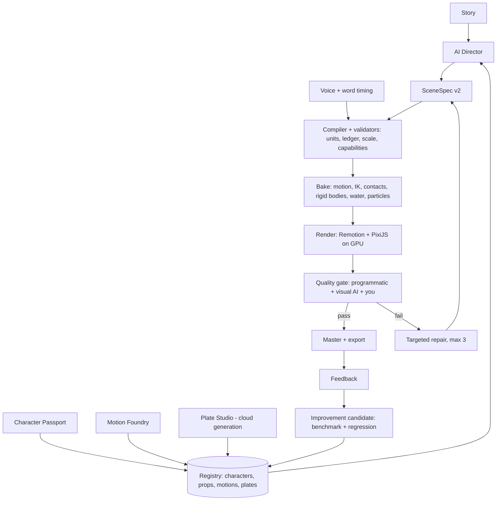

# AI Stickman Engine: Final Plan

Version 2.0, 23 October 2026. Prepared for Suprotim Mukherjee.
Merges the architecture plan v1.0 (PDF) with the v2 improvements (`01-architecture-v2.md`) and the pilot.
Detail documents: `00-plan-review.md` (why v2), `02-pilot-plan.md`, `03-roadmap.md`, `04-quality-scorecard.md`,
`05-asset-specs.md`.

---

## 1. Goal and positioning

Build an engine that turns a story into stick-figure animation that competes with Higgsfield, Kling and Seedance-class
video models, on **stick-figure stories with realistic motion and correct physics**.

| We win by design | We match through hybrid generation | We do not try to win |
|---|---|---|
| The same character in every shot and episode | Painterly backgrounds and lighting (style-locked generated plates) | Photoreal humans |
| Physically correct, directable action: contact, weight, buoyancy, scale | Organic motion detail (motion library acted by real people) | Open-ended "type anything" generation |
| Objects that behave like objects: float, sink, strand, break | Hero water shots (generated plates composited behind the characters) | |
| Exact timing to voice, captions, countdowns and sound | | |
| Edit one shot without regenerating everything; low cost per iteration | | |

**Principle:** generative models create *looks*; the engine owns *truth*. Characters, props, physics, timing and text
come from versioned, validated, deterministic data. Generated media enters only as style-locked background plates and
hero effect plates.

**Defining example (the drawdown):** before the second wave, the sea pulls back past the old shoreline. The
streets and harbor floor are exposed: fish flop on wet mud, broken cars lie tilted where the water dropped them,
boats rest on their keels, rocks and debris lines mark where the water stood, puddles remain in the low spots, the
wet ground dries in patches. Then the horizon turns white. Every object in that shot is a clear, consistent 2D asset,
and every object's position is the result of physics, not hand placement.

---

## 2. Architecture decision

An **AI director** produces validated scene data on top of a **controlled animation engine**. Versioned characters,
props, motions and plates determine the visual execution. Physics is simulated once and **baked** to tracks.
Remotion controls timing and export; PixiJS draws on the GPU. A quality gate triggers bounded, targeted repairs.
Improvements are promoted only after a fixed benchmark.

| Layer | Implementation |
|---|---|
| Editor and API (phase 7) | Next.js + TypeScript editor with Remotion Player; NestJS modular API |
| Scene contracts | SceneSpec v2 (Zod), metres as the unit, continuity ledger, capability registry |
| Characters | Character Passport: generated sheet → parts → rig with IK and contact locks → identity fingerprint |
| Motion | Motion Foundry: reference video → 2D pose → retarget → contacts → clip library with blending |
| Objects | Prop & Debris Registry: size, mass, density, collider, damage states, waterline, stranding |
| Physics | Rapier 2D (deterministic build) + custom buoyancy and drag; water heightfield; particles; baked tracks |
| Looks | Plate Studio: style-locked generated plates, depth layers, parallax; hero effect plates |
| Render | Remotion + PixiJS (WebGL via Vulkan on the GPU); lighting, grade, captions, sound |
| Jobs and data (phase 7) | BullMQ + Redis; PostgreSQL; object storage; pgvector when retrieval needs it |
| AI and evaluation | Provider adapters (planning, visual review, image/video generation); benchmark-gated promotion |



---

## 3. Engine design

### 3.1 Units, coordinates, scale
Metres are canonical. Person 1.70 m, child 1.30 m, floor 3.2 m, car 4.5 × 1.5 m, door 2.0 × 0.9 m, fish 0.3–0.8 m.
The camera alone converts metres to pixels. A **scale validator** fails any scene where person:door, person:floor or
person:car ratios are more than 15% off.

### 3.2 SceneSpec v2
Frames are the timeline unit. Every asset, rig, motion, plate and engine version is resolved to an immutable version
before baking. Example (`02-pilot-plan.md` has the full pilot scenes):
```json
{
  "sceneId": "drawdown", "fps": 30, "durationFrames": 300, "seed": "qc-drawdown-1", "units": "m",
  "ledgerIn": "after_first_wave",
  "cast": [{"id": "ravi", "passport": "ravi@4"}, {"id": "mia", "passport": "mia@2"}],
  "water": {"type": "drawdown", "from": "level_after_wave", "to": "below_harbor_floor", "startFrame": 0, "endFrame": 180},
  "spawn": [
    {"set": "stranded_fish@1", "count": 18, "zone": "harbor_floor"},
    {"set": "wrecked_cars@2", "count": 5, "zone": "street"},
    {"set": "flood_debris@3", "count": 40, "zone": "all"},
    {"set": "rocks@1", "count": 25, "zone": "harbor_floor"}
  ],
  "shots": [{"from": 0, "to": 150, "framing": "wide"}, {"from": 150, "to": 300, "framing": "medium", "subject": ["ravi", "mia"]}],
  "actions": [{"actor": "ravi", "motion": "walk_mud@1", "start": 150, "contacts": ["feet:ground"]}],
  "events": [{"type": "horizon_white", "frame": 270}],
  "constraints": ["scale_valid", "feet_contact", "no_penetration", "identity_match", "objects_rest_on_ground"]
}
```

### 3.3 Continuity ledger
A typed record carried across shots and parts: time of day, weather, water level, structural damage, costume state,
prop ownership, injuries, character positions. Damage and wetness never decrease; time moves forward unless a shot is
tagged as flashback; scene-end positions equal the next scene's start. Debris and stranded objects persist: a car left
on the street in one shot is still there in the next.

### 3.4 Character Passport (consistent characters)
You generate turnaround and paper-doll sheets (`05-asset-specs.md`). The engine segments the parts, annotates joints,
pivots and layering, builds a rig with 2-bone IK and foot/hand locks, and stores a fingerprint (limb ratios, palette,
silhouette, line weight). Every rendered shot is checked against the fingerprint. Costume carries identity (Ravi's
apron, Mia's yellow raincoat); faces stay minimal for now.

### 3.5 Prop & Debris Registry (perfect objects)
Every object on screen comes from the registry, never drawn ad hoc.
```json
{"id": "car_sedan_wreck", "version": 2, "size_m": [4.5, 1.5], "mass_kg": 1300, "density": 0.35,
 "collider": "convex", "states": ["intact", "dented", "wreck", "flipped", "half_buried"],
 "water": {"floatsAt": 0.6, "tilt_deg": [10, 25], "strands": true},
 "layers": ["body", "glass_cracked", "wheels", "mud_overlay"]}
```
Drawdown sets: **stranded fish** (3 species, rigged spine for flopping, wet sheen), **rocks** (5 sizes, static
colliders), **wrecked cars** (4 variants), **boats aground** (keel contact, tilt), **flood debris** (planks, roof sheets,
tyres, crates, doors, logs, branches, nets), **seabed dressing** (seaweed, shells, puddles). Each set has intact,
broken and wet/muddy variants generated in one style.

### 3.6 Physics: four tiers, baked and tested

| Tier | Model | Covers | Tests |
|---|---|---|---|
| 1. Rigid bodies | Rapier 2D deterministic build, fixed 1/120 s step, custom buoyancy and drag | Debris, cars, boats, rocks, collapse pieces | No tunnelling; rest stability; identical tracks for the same seed |
| 2. Water surface | Heightfield (shallow-water style) on the terrain, with obstacles, surge fronts and drawdown flow | Floods, surges, the retreat, puddles left in low ground | Wave speed ≈ √(g·depth) within 15%; volume conserved; floats sit at density waterline ±10% |
| 3. Particles | Seeded spray, foam, drips, mud splashes, wet-to-dry ground shading | Impacts, crests, receding foam, drying ground | Spray within 1 frame of each impact; nothing emitted from calm water |
| 4. Hero plates | Generated video plates, matted and colour-matched | Giant crest and crash close-ups | Horizon, light and timing match the scene |

**Drawdown and stranding (what makes the example work):**
1. The heightfield drains seaward; the shoreline retreats past the old waterline at a set speed.
2. As depth under a floating body falls below its draft, it **settles**: it lands on the terrain, takes the contact
   normal's tilt and stays put. Cars end tilted or half-buried; boats lie on their keels.
3. Fish are spawned in the last water of each low spot. When it drains, they are stranded and **flop**: a spring-damper
   spine driven by decaying random impulses, with mud splashes on contact.
4. Water left in terrain dips becomes **puddles** (local heightfield minima). A **wrack line** of debris and foam marks
   the highest retreat point.
5. Ground shading moves from wet (dark, reflective sheen) to drying (patchy) over time.
6. The next wave: the horizon whitens, the retreat stops, and the surge front forms (tier 2), with optional hero plate (tier 4).

### 3.7 Motion Foundry (realistic motion)
Reference video (you acting, or licensed clips) → 2D pose estimation (MediaPipe / RTMPose, runs on CPU) → retarget to
the rig → contact detection (foot plants, hand grips) → filtering → clip with metadata (loop, blend frames, speed in m/s,
contacts). At bake time, clips blend; feet and hands lock to surfaces (roof, stair treads, ladder rungs, raft, mud);
IK resolves the last centimetres; anticipation, landing compression and follow-through come from the acted reference.
Mud and water change gait (slower steps, deeper knee bend, splash particles on each foot plant).
Library: idle, walk, walk-mud, run, run-stop, stairs-up, climb-ladder, jump-gap, carry-child, shield-crouch, paddle,
slip-recover, look-back, look-up, flashlight-raise, wave-arms.

### 3.8 Plate Studio (looks)
A reference board fixes the style; plates are generated per shot in the cloud (9:16, ≥ 2048 px tall), split into 3–5
depth layers on your PC, gaps filled, and moved with a parallax camera. Hero effect clips (the crest, the crash) come
from a video model, are matted and colour-matched. Later: a cloud-trained style model for exact style lock.

### 3.9 Render, lighting and sound
Per frame: `t = frame / fps` → sample baked tracks → draw plates, world, water shader (refraction, foam, wet sheen),
props with waterline clipping, characters, particles, text → rim light and contact shadows → colour grade per act →
grain. All on the GPU (Vulkan backend; measured ~15× faster than software on the GTX 1050). No independent tickers.
Sound: every physics event emits a cue with intensity (impact, splash, fish flop, debris scrape); layered effects
from a licensed library; music stems with ducking under voice; 3–5 voice takes per line with emotion tags; master at
−14 LUFS.

---

## 4. Quality, benchmark and competition

### 4.1 Quality gate
Programmatic checks (thresholds in `04-quality-scorecard.md`): scale, contacts (≤ 1 cm slip per frame), penetration
(≤ 2 cm), joint limits, identity, jitter, physics events, objects at rest on the ground after drawdown, audio sync
(≤ 2 frames), text safe zone and contrast, loudness, determinism. Visual AI reviews event keyframes and short windows
(labelled advisory). You review benchmark shots. AI scores are never the only release gate.

### 4.2 Repair policy
Each defect is `{scene, frames, category, evidence, confidence, fix}`. Patch the smallest field, motion track or
asset; keep accepted layers; re-check dependents; stop after 3 attempts per shot; keep the best candidate.

### 4.3 Benchmark suite (fixed, plus unseen variations)
1. Walk to a stop. 2. Run uphill, turn, look back. 3. Ladder climb with hand contact. 4. Stairs with a child carried.
5. Jump between roofs. 6. Paddle a raft past debris. 7. Surge crossing a town, buildings break. 8. Impact on a tower
with spray. 9. Water rising up a facade. 10. **Drawdown: the sea retreats; fish, wrecked cars, boats, rocks and debris
left behind; the horizon turns white.** 11. Night SOS and a helicopter searchlight. 12. Emotional body-language
close-up. 13. Captions, countdown and slam over a busy scene.

### 4.4 Competitive benchmark (vs Higgsfield, Kling, Seedance)
- Write the same short scene prompt for each of benchmarks 4, 7, 8 and 10, at 9:16 and the same length.
- Generate with each competitor (best of 3 attempts, as a user would) and with the engine (first accepted output).
- Blind A/B with at least 10 viewers per pair, rating: character consistency, physical correctness, object clarity,
  motion realism, overall looks.
- Also record what each needed: attempts, edits, cost and time to an acceptable clip.
- **Release target:** the engine wins on consistency, physics and object clarity in at least 3 of 4 scenes, and is
  rated at least comparable on looks in 60% of pairs.

### 4.5 Learning and promotion
Every attempt stores spec, parent attempt, input hashes, engine/asset/model/prompt versions, seed, preview, defects,
patch, your decision, cost and render settings. Failed candidates are diagnostics, not instructions. A change is
promoted only if it beats or holds the benchmark and passes unseen variations; previous versions stay for rollback.
Retrieval starts file-based; pgvector comes when there are hundreds of approved examples. Fine-tuning is a separate,
later project.

---

## 5. Pilot: "The Drawdown → The Hit" (30 seconds)

Proves the engine on the hardest content before any platform work. About 7 working weeks. Full plan: `02-pilot-plan.md`.

| Scene | Length | Proves |
|---|---|---|
| A. The Drawdown | 10 s | Water retreat, stranding and settling physics; fish flopping; clear wreck/debris assets; walking in mud; the horizon whitening |
| B. The Hit | 20 s | Carrying a child on stairs; surge across a town with breaking buildings; impact and spray; water climbing a facade; camera wide → close; sound and text synced to impact |

**Go/no-go gates:** bit-identical re-renders; zero critical defects; beats today's version of the same scenes by
≥ 2 points in motion, physics and art; competitive benchmark on scenes A and B meets the release target; full
30 s render ≤ 8 min on your GTX 1050.

---

## 6. Roadmap

| Phase | Deliverable | Gate |
|---|---|---|
| 0. Pilot | Drawdown + Hit scenes on the v2 engine | Go decision |
| 1. Baseline extraction | Migrate The Quiet Coast to SceneSpec v2; versioned assets; baseline metrics | Re-render from pinned inputs with no scene-code edits |
| 2. Engine breadth | ~20 motions; full Prop & Debris Registry; fracture; shot grammar; sound stems | All benchmark programmatic checks pass |
| 3. AI director | Capability registry; story → beats → shots → SceneSpec; voice timing first | A new story produces a valid, coherent preview first time |
| 4. Looks | Plate Studio at scale; style model; hero plates; lighting presets | Comparable looks in ≥ 60% of competitive pairs |
| 5. QA and repair | Visual AI review; automatic bounded repair | Seeded defects found; repairs stay local; spend limits hold |
| 6. Learning memory | Feedback, retrieval, benchmark-gated promotion and rollback | Fewer corrections on unseen scenes; no regression |
| 7. Platform | Next.js editor, NestJS API, BullMQ + Redis, PostgreSQL, object storage, render worker pool | Restarts resume safely; idempotent provider calls; cost per accepted second tracked |

**Defer:** custom model training, multiple physics engines, a microservice fleet, full fluid simulation, unrestricted
generated code. Add each only when a measured limitation justifies it.

---

## 7. Interfaces and operations (phase 7)

| Interface / record | Minimum contents |
|---|---|
| `POST /projects/:id/jobs` | Input spec, output format, immutable project version, idempotency key → job ID |
| `GET /jobs/:id` | Stage, progress, attempts, cost estimate, defects, signed output URLs (SSE for progress) |
| `POST /attempts/:id/feedback` | Accepted/rejected, frame range, category, comment → evaluation candidate (never auto-promotion) |
| Database records | projects, project_versions, assets, asset_versions, motion_versions, scenes, jobs, attempts, defects, feedback, lessons, evaluation_runs, promotions |
| Artifact manifest | Input hashes; scene, asset, engine versions; render environment; provider outputs; baked tracks; output keys |

Checkpoint each expensive stage; cache by input hash; check provider job status before resubmitting; per-job repair,
token and spend budgets; cancellation; one job ID across queue latency, stage durations, failures and cost. Render
browsers run in isolated containers with resource limits; generated components go through a separate test path;
credentials stay on the server.

---

## 8. Hardware, cost and environment

| Work | Where |
|---|---|
| Rendering, physics bake, pose extraction, depth split, QA | Your PC (i5-8300H, 32 GB RAM, GTX 1050 4 GB via Vulkan) |
| Image and video generation, later style-model training | Cloud (ChatGPT, Google Flow, Kling, Veo, or an API such as fal.ai / Replicate) |
| Production rendering at volume (phase 7) | Remotion Lambda or a render worker pool |

Pin Chrome, Remotion and `--gl=vulkan`; frames must be bit-identical within one environment and ≥ 45 dB PSNR across
GPU backends (measured 47 dB). Keep caches on D: (C: has ~14 GB free).

---

## 9. Risks

| Risk | Mitigation |
|---|---|
| Generated sheets don't separate cleanly into parts | Strict sheet spec, paper-doll layout, manual cleanup of the first characters |
| Noisy pose extraction | Side-on filming, plain background; filtering, contact locks, keyframe fallback |
| Physics differs across machines | Deterministic build, fixed step, bake once and render only from stored tracks |
| 4 GB GPU memory | Texture atlases, plates ≤ 4096 px, one PixiJS app per frame |
| Competitors improve faster on looks | Compete where they are structurally weak: consistency, control, physics, objects, cost per iteration |
| Platform work crowds out quality | Platform starts only after the pilot's go decision |

## 10. References
Remotion deterministic rendering (remotion.dev/docs/flickering) · Remotion animation timing
(remotion.dev/docs/animating-properties) · GSAP timeline seek (gsap.com/docs/v3/GSAP/Timeline/seek()) · Rapier
determinism (rapier.rs/docs/user_guides/javascript/determinism) · pgvector (github.com/pgvector/pgvector)
